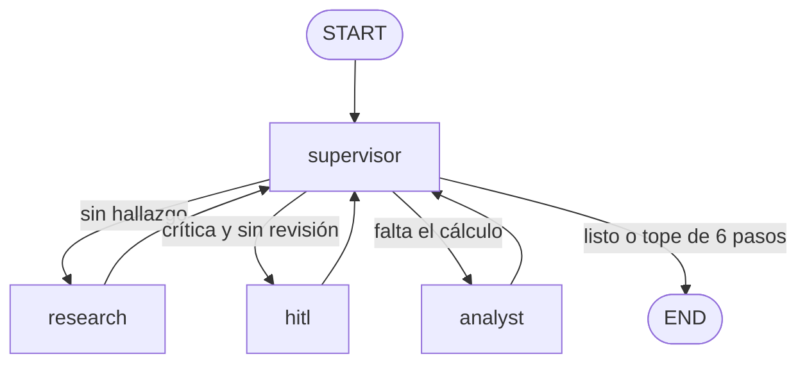

# Sistema Intelligence

API que junta recuperación híbrida, un supervisor de agentes y aprobación humana. El estado del grafo queda en Redis: si el proceso se cae, la conversación sigue en el mismo `job_id`.



`research` consulta Chroma y BM25. Si el total pasa `UMBRAL_CRITICO` o el pedido dice "crítico", `hitl` pausa el grafo con `interrupt` hasta `POST /tasks/{id}/approve`.

## Levantar

Una sola instrucción, con Docker:

```bash
./run.sh
```

Eso es `docker compose up --build`. Redis Stack queda en el puerto 6391, Phoenix en http://localhost:6006 y la API en http://localhost:8000. La documentación interactiva está en http://localhost:8000/docs.

Sin Docker, con Redis Stack ya corriendo:

```bash
cp .env.example .env
pip install -r requirements.txt
uvicorn app.main:app --port 8000
```

El modelo y la colección no van fijos en el código: salen de `OPENAI_MODEL` y `CHROMA_COLLECTION`. Sin `OPENAI_API_KEY` las herramientas igual responden; el modelo solo redacta cuando hay clave.

## API

```bash
curl -s -X POST localhost:8000/tasks \
  -H 'content-type: application/json' \
  -d '{"query":"¿Cuántos pedidos tiene el cliente 7?"}'

curl -s localhost:8000/tasks/<job_id>

curl -s -X POST localhost:8000/tasks/<job_id>/approve \
  -H 'content-type: application/json' \
  -d '{"aprobado": false}'
```

Estados: `PENDING`, `RUNNING`, `WAITING_APPROVAL`, `DONE`, `REJECTED`, `FAILED`. Un id que no existe responde 404. Las entradas y salidas están validadas con Pydantic, igual que los argumentos de las herramientas.

Cinco peticiones a la vez:

```bash
python scripts/carga.py
```

## Trazas

Con `PHOENIX_ENABLED=1` cada corrida manda spans a Phoenix (proyecto `sistema-intelligence`). LangSmith se activa con `LANGCHAIN_TRACING_V2=true` y `LANGCHAIN_API_KEY`. Ahí se ven las 5 pruebas, el nodo que corrió y el retriever.

## Datos de la base

| Id | Pedidos | Total | Qué pasa |
| --- | --- | --- | --- |
| 7 | 2 | 800 | Termina solo. Ticket promedio 400. |
| 441 | 1 | 3500 | Termina solo. |
| 102 | 3 | 14500 | Espera aprobación. |
| 318 | 5 | 22000 | Espera aprobación. |

También hay dos políticas: reembolso (30 días) y envío (5 días hábiles o 48 horas).
